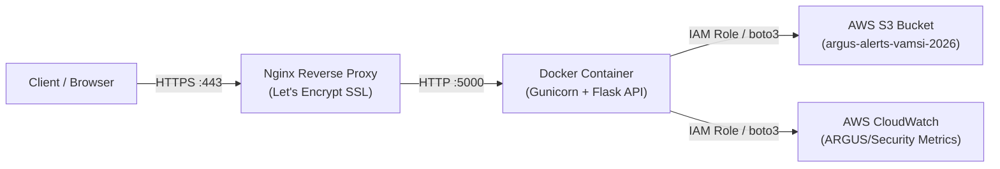

# ARGUS — Alert Response & Guardian Unified System

ARGUS is a production-ready, cloud-native alert ingestion and monitoring platform deployed on AWS. Built with Flask, containerized with Docker, proxied with Nginx (SSL/TLS enabled via Let's Encrypt), and backed by Amazon S3 storage with AWS CloudWatch metric integration and Terraform Infrastructure as Code.

[](https://github.com/vamsimuddada/Argus/actions/workflows/ci.yml)
[](https://opensource.org/licenses/MIT)

## 🌐 Live Deployment
- **Dashboard (HTTPS):** [https://3.25.134.199.nip.io/](https://3.25.134.199.nip.io/)
- **Health Check:** `https://3.25.134.199.nip.io/health`

---

## 🏛️ Architecture



- **Compute:** AWS EC2 (`t3.micro`, Amazon Linux 2023)
- **Containerization:** Docker multi-stage image with Gunicorn WSGI
- **Web Server:** Nginx reverse proxy with automated Let's Encrypt SSL/TLS renewal (Certbot)
- **Storage:** Amazon S3 bucket with IAM Instance Profile authentication (zero hardcoded secrets)
- **Monitoring:** CloudWatch Metric Alarms (CPU > 80%, StatusCheckFailed) & custom application metrics
- **Infrastructure as Code:** Complete Terraform module (`/terraform`) provisioning all AWS resources
- **CI/CD:** GitHub Actions pipeline automating linting, testing, and continuous deployment

---

## 🚀 Key Features

- **RESTful API:** Endpoints to ingest, filter, acknowledge, and resolve alerts.
- **Persistent Cloud Storage:** Automated upload of alert payloads to S3 with local disk fallback.
- **Enterprise Security:** HTTPS enforced, strict IAM role permissions, security groups restricted by protocol.
- **Automated CI/CD:** GitHub Actions running unit test matrices and deploying to EC2 on push.
- **Infrastructure as Code (IaC):** 100% reproducible deployment using Terraform.

---

## 🛠️ Tech Stack

- **Backend:** Python 3.12, Flask, Pydantic, Gunicorn, Boto3
- **Cloud & DevOps:** AWS (EC2, S3, IAM, CloudWatch), Docker, Nginx, Certbot
- **IaC & Automation:** Terraform, GitHub Actions, Bash
- **Testing:** Pytest (14/14 passing)

---

## 📦 Infrastructure as Code (Terraform)

Provision the complete AWS infrastructure in a single command:

```bash
cd terraform
terraform init
terraform plan
terraform apply
```

See [terraform/README.md](terraform/README.md) for full configuration parameters and variable definitions.

---

## 🧪 Local Development & Testing

```bash
# Clone repository
git clone https://github.com/vamsimuddada/Argus.git
cd Argus

# Create virtual environment
python -m venv .venv
source .venv/bin/activate  # Or .\.venv\Scripts\Activate.ps1 on Windows

# Install dependencies
pip install -r requirements.txt

# Run test suite
pytest tests/ -v
```

---

## 📄 License
MIT License. Created by Vamsi Muddada.
