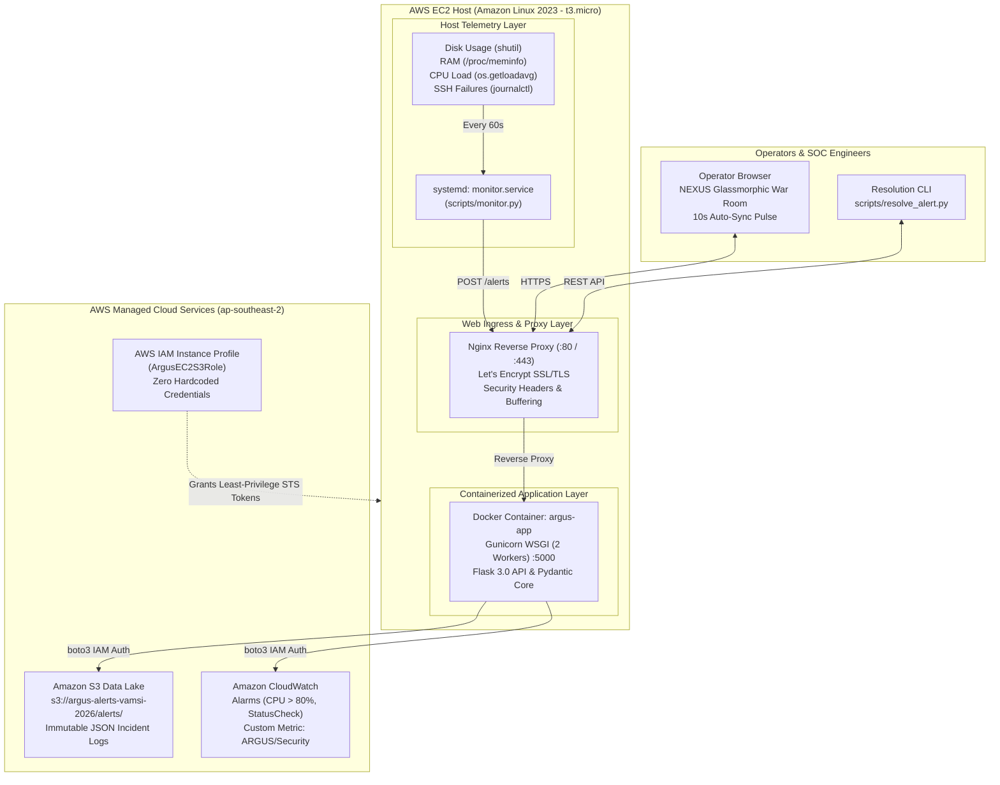

# 🛡️ ARGUS — Alert Response & Guardian Unified System

[](https://github.com/vamsimuddada/Argus/actions/workflows/ci.yml)
[](https://www.python.org/)
[](https://aws.amazon.com/)
[](https://www.terraform.io/)
[](https://www.docker.com/)
[](https://nginx.org/)
[-brightgreen?logo=pytest)](https://docs.pytest.org/)
[](https://opensource.org/licenses/MIT)

**ARGUS** is an enterprise-grade cloud incident monitoring, telemetry collection, and automated alerting platform deployed live on Amazon Web Services (AWS). Designed to emulate modern Site Reliability Engineering (SRE) and Security Operations Center (SOC) workflows, ARGUS couples a continuous Linux systemd host daemon with a containerized REST API, an Amazon S3 cloud data lake, AWS CloudWatch metrics, automated GitHub Actions CI/CD, and Terraform Infrastructure as Code.

---

## 🌐 Live Production Deployment

| Service | Target URL | Protocol & Security |
| :--- | :--- | :--- |
| **War Room Console** | **[https://3.25.134.199.nip.io/](https://3.25.134.199.nip.io/)** | HTTPS (Let's Encrypt TLS v1.3) |
| **HTTP Fallback** | **[http://3.25.134.199/](http://3.25.134.199/)** | HTTP Reverse Proxy |
| **API Health Probe** | `https://3.25.134.199.nip.io/health` | Automated Load Balancer Probe |
| **Alerts Stream API** | `https://3.25.134.199.nip.io/alerts` | JSON Telemetry Stream |

---

## 🏛️ System Architecture



---

## 🚀 Key Engineering Highlights

### 1. ⚡ 24/7 Systemd Background Telemetry Daemon (`monitor.service`)
- Operates as a persistent, self-healing Linux service (`Restart=always`, `RestartSec=10`).
- **Telemetry Collected Every 60s:**
  - **Storage Pool Utilization:** Monitors root `/` volume via `shutil.disk_usage`.
  - **Virtual Memory Saturation:** Reads `/proc/meminfo` (`MemTotal` vs `MemAvailable`).
  - **Normalized CPU Load:** Parses 1-minute system load normalized by CPU core count.
  - **SSH Brute-Force Activity:** Inspects `journalctl -u sshd` authentication logs for failed password attempts and invalid users.
- **Smart Rate-Limiting:** Incorporates stateful deduplication to eliminate alert storms while an incident threshold is continuously breached.

### 2. 🪣 Cloud S3 Data Lake & State Re-Hydration
- Every ingested incident payload is saved as an immutable, timestamped JSON document in Amazon S3 (`s3://argus-alerts-vamsi-2026/alerts/<id>.json`).
- **Zero-Secret Authentication:** EC2 instance communicates via an attached AWS IAM Instance Profile (`ArgusEC2S3Role`), completely eliminating static API keys from code and containers.
- **Resilient Startup Hydration:** When the Docker container boots or restarts, `_sync_from_storage()` automatically restores active state from S3.

### 3. ✅ Closed-Loop Incident Lifecycle (Open ➔ Acknowledged ➔ Resolved)
- **Interactive Web Console:** Real-time action buttons allow operators to acknowledge active alerts or resolve them instantly.
- **Command-Line Resolution Utility:** SOC analysts can resolve alerts directly from terminal sessions:
  ```bash
  # Resolve a specific incident
  python3 scripts/resolve_alert.py <alert_id>

  # Batch resolve all open alerts
  python3 scripts/resolve_alert.py --all
  ```
- **S3 State Mirroring:** State transitions update the `status` and append `resolved_at` timestamps in both memory and S3.

### 4. 🏗️ Infrastructure as Code (Terraform)
- Complete, modular Terraform configurations located in `/terraform`:
  - EC2 instance (`t3.micro`, Amazon Linux 2023).
  - Security Groups with port-level CIDR restrictions (SSH 22, HTTP 80, HTTPS 443).
  - S3 bucket with private ACLs and `aws_s3_bucket_public_access_block`.
  - IAM role, trust policy, and instance profile.
  - CloudWatch metric alarms for high CPU utilization (>80%) and EC2 status check failures.

### 5. 🔄 CI/CD Pipeline (GitHub Actions)
- Automated workflow (`.github/workflows/ci.yml`) runs on every push and pull request across Python 3.11 and 3.12 matrices.
- Runs Pytest unit tests with coverage reporting.
- On merge to `master`/`main`, automatically SSHs into the live EC2 host to pull the update, rebuild the Docker image, and restart the container with zero manual intervention.

---

## 📡 REST API Reference

| Method | Endpoint | Description | Request Body | Response Codes |
| :--- | :--- | :--- | :--- | :--- |
| `GET` | `/health` | Health check endpoint for uptime monitors | None | `200 OK` |
| `GET` | `/` | Renders the HTML War Room Dashboard | None | `200 OK` |
| `GET` | `/alerts` | Returns all alerts (filter: `?status=` & `?severity=`) | None | `200 OK` |
| `POST` | `/alerts` | Ingests a new incident payload | JSON (`title`, `severity`, `source`, `desc`) | `201 Created` / `422` |
| `GET` | `/alerts/<id>` | Retrieves a specific incident by ID | None | `200 OK` / `404` |
| `POST` | `/alerts/<id>/acknowledge` | Transitions incident state to `acknowledged` | None | `200 OK` / `404` |
| `POST` | `/alerts/<id>/resolve` | Closes incident with `resolved_at` timestamp | None | `200 OK` / `404` |
| `DELETE` | `/alerts/<id>` | Deletes an incident from active store | None | `200 OK` / `404` |

---

## 🛠️ Tech Stack & Tooling

```
Cloud Infrastructure : AWS (EC2, S3, IAM Instance Profile, CloudWatch)
Operating System     : Amazon Linux 2023 (Linux 6.1 Kernel)
Process Supervisor   : Systemd (monitor.service)
Web Server & Proxy   : Nginx 1.30.7, Certbot (Let's Encrypt TLS v1.3)
Application Runtime  : Python 3.12, Flask 3.0, Pydantic 2.0, Gunicorn 27.0
Cloud SDK            : Boto3, AWS CLI v2
Containerization     : Docker multi-stage build
Infrastructure as Code: Terraform >= 1.5.0 (AWS Provider v5.0)
Continuous Delivery  : GitHub Actions (Multi-matrix Pytest + SSH Deploy)
Testing & Quality    : Pytest, Pytest-Cov (14 tests, 76% coverage)
```

---

## 📦 Infrastructure as Code (Terraform)

To provision or duplicate this entire infrastructure stack:

```bash
cd terraform

# 1. Initialize providers
terraform init

# 2. Review execution plan
terraform plan -var="bucket_name=argus-alerts-yourname-2026" -var="key_name=your-key"

# 3. Apply infrastructure
terraform apply -auto-approve
```

See [terraform/README.md](terraform/README.md) for full variable declarations and output references.

---

## 🔧 Operational Runbook & Server Administration

### Managing the 24/7 Monitor Service
```bash
# Check daemon status
sudo systemctl status monitor.service

# View live telemetry logs
journalctl -u monitor.service -f

# Restart daemon
sudo systemctl restart monitor.service
```

### Managing the Application Container
```bash
# View active container status
sudo docker ps -a

# Inspect live Gunicorn logs
sudo docker logs -f argus-app

# Rebuild and restart container
cd ~/Argus
sudo docker build -t argus .
sudo docker stop argus-app && sudo docker rm argus-app
sudo docker run -d --name argus-app --restart always -p 5000:5000 --env-file ~/Argus/.env argus
```

### Managing Nginx & SSL Certificates
```bash
# Test Nginx syntax
sudo nginx -t

# Reload configuration
sudo systemctl reload nginx

# Test automated SSL renewal dry-run
sudo certbot renew --dry-run
```

---

## 🧪 Local Setup & Development

```bash
# 1. Clone the repository
git clone https://github.com/vamsimuddada/Argus.git
cd Argus

# 2. Create virtual environment
python -m venv .venv
# Linux / macOS:
source .venv/bin/activate
# Windows:
.\.venv\Scripts\Activate.ps1

# 3. Install dependencies
pip install -r requirements.txt

# 4. Run Pytest suite with test coverage
pytest -v --cov=app
```

---

## 🎯 System Reliability & Security Design Decisions

1. **Zero Hardcoded Secrets:** Authentication to AWS S3 and CloudWatch relies entirely on IAM Roles via the EC2 Instance Metadata Service (`IMDSv2`), eliminating the attack surface of leaked credential files or API keys.
2. **Defense in Depth Web Routing:** The Flask WSGI container never binds directly to public ports. Nginx handles TLS termination, request buffering, and HTTP header sanitization before routing to Gunicorn on localhost.
3. **Resilient Data Accumulation:** System telemetry is decoupled from the web application. Even if the web tier restarts, `monitor.service` continues to poll and dispatch incidents, while S3 preserves historical incident integrity.
4. **Automated Incident Lifecycle:** Alert records support full lifecycle traceability (`open` ➔ `acknowledged` ➔ `resolved`) with immutable ISO 8601 UTC audit timestamps.

---

## 📄 License
Distributed under the MIT License. Developed by **Vamsi Muddada**.
